Desde que lancei a primeira versão do driver para o Metabase, que permite a conexão com endpoints SPARQL, queria compartilhar aqui o processo de construção de um dashboard. O código está público desde 25 de junho de 2025, mas a ideia e a construção começaram bem antes, a partir da observação de uma demanda da própria comunidade e de um desejo pessoal de fazer uma ferramenta de BI consolidada consultar dados da Web Semântica. O repositório pode ser encontrado em <https://github.com/jhisse/metabase-sparql-driver>, junto com todas as instruções para utilizar o driver na sua instância do Metabase ou executar uma nova instância a partir de uma imagem Docker já pronta.

Para esse tutorial escolhi o [endpoint SPARQL de prêmios Nobel](https://data.nobelprize.org/), que é público e não exige autenticação. Com ele quero extrair uma visão ao longo do tempo das categorias premiadas, dos países e universidades dos laureados, da distribuição por gênero e de informações dos próprios ganhadores. No caminho, vou descer um pouco no nível de abstração e mostrar o que o driver envia ao endpoint, como um documento SHACL vira tabelas e colunas no Metabase, e qual SPARQL sai de uma consulta montada no query builder.

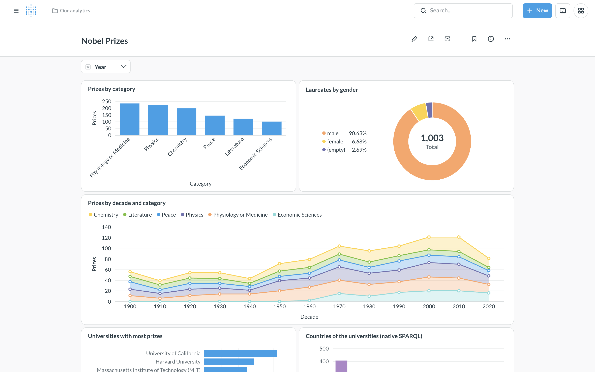

## O que o driver faz

O Metabase conversa com qualquer banco por meio de um driver, que tem duas responsabilidades, descobrir o esquema (sync) e executar consultas. Em um banco relacional, o esquema vem do catálogo e as consultas viram SQL. Em um endpoint SPARQL não existe catálogo. Existem triplas `sujeito predicado objeto`, e o esquema é uma convenção. O driver resolve isso tratando cada classe RDF (`rdf:type`) como uma tabela e cada propriedade como uma coluna. A IRI do sujeito vira a coluna `subject`, chave primária de toda tabela.

![Diagrama com três zonas: Metabase, driver SPARQL e o endpoint SPARQL do Nobel. No caminho de consulta, o query builder passa por mbql.clj e a consulta em SPARQL com variáveis por parameters.clj; os dois chegam a execute.clj, que envia um HTTP POST ao endpoint, e a resposta em JSON volta por conversion.clj como linhas tipadas para tabelas, gráficos e dashboards. No caminho de sync, o documento SHACL colado no formulário de conexão passa por shacl.clj e dimensions.clj e vira tabelas, colunas e chaves estrangeiras](images/diagrama-arquitetura.png)

Há dois caminhos no diagrama. O de **sync** acontece quando o banco é adicionado e depois periodicamente. Nele, o driver monta a lista de tabelas e colunas e entrega ao Metabase. Neste post o esquema vem de um documento SHACL, mas o driver também sabe descobrir classes e propriedades por amostragem (`auto`), receber o esquema em JSON (`explicit`) ou não sincronizar nada (`none`), útil para endpoints grandes demais para amostrar, como o Wikidata.

O de **consulta** acontece sempre que um gráfico ou uma tabela é carregado. O que foi montado no query builder chega ao driver em MBQL, a linguagem intermediária do Metabase, e é compilado para SPARQL. O que foi escrito à mão já chega em SPARQL, e o driver só troca cada variável `{{tag}}` por um termo SPARQL, com os caracteres especiais escapados. Nos dois casos, o resultado é uma requisição HTTP ao endpoint:

```http
POST /store/sparql HTTP/1.1
Host: data.nobelprize.org
Content-Type: application/x-www-form-urlencoded
Accept: application/sparql-results+json, application/json;q=0.9
User-Agent: metabase-sparql-driver (https://github.com/jhisse/metabase-sparql-driver)

query=SELECT+...
```

A resposta segue o formato [SPARQL 1.1 Query Results JSON](https://www.w3.org/TR/sparql11-results-json/). Cada célula traz o valor, o tipo (`uri` ou `literal`) e, para literais, o datatype XSD ou a tag de idioma. O driver usa esses metadados para converter cada célula em um tipo do Metabase. Assim, `xsd:integer` vira Integer, `xsd:date` vira Date, `xsd:boolean` vira Boolean, uma IRI vira URL e um literal com tag de idioma vira Text sem a tag. Sem essa conversão, tudo chegaria como texto e nenhum gráfico de linha ou filtro de data funcionaria.

## Subindo o Metabase com o driver

A forma mais rápida é a imagem Docker publicada a cada release, que é a imagem oficial do Metabase com o driver já na pasta de plugins. Neste post usei a versão 0.0.23 do driver, que acompanha o Metabase 0.64.6.2, e fixei a tag da imagem para que o resultado seja o mesmo em qualquer data:

```bash
docker run -d -p 3000:3000 ghcr.io/jhisse/metabase-sparql-driver:v0.0.23
```

Se você já tem um Metabase, basta baixar o `sparql.metabase-driver.jar` da página de releases, copiá-lo para a pasta `plugins/` e reiniciar. O arquivo `resources/metabase-plugin.yaml` dentro do jar declara os campos do formulário de conexão que aparece a seguir.

## Conectando ao endpoint

Em **Admin → Databases → Add database**, o tipo SPARQL aparece na lista. O formulário tem mais campos do que um banco relacional, porque parte do que seria o catálogo precisa ser dito ao driver.

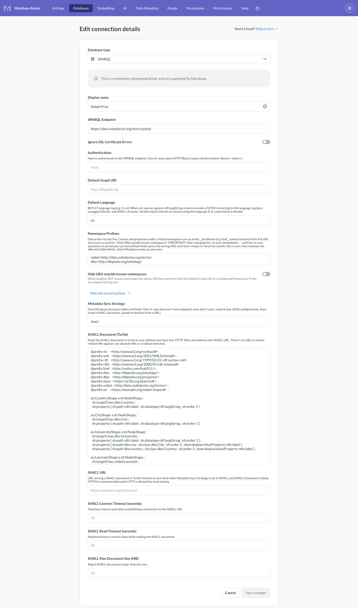

Os campos que importam para este endpoint:

- **SPARQL Endpoint**: `https://data.nobelprize.org/store/sparql`.
- **Default Language**: `en`. Os rótulos do Nobel existem em inglês, sueco e norueguês. Sem esse campo, cada universidade apareceria três vezes, uma por idioma. Com ele, toda coluna declarada como `rdf:langString` no SHACL ganha um `FILTER` de idioma na consulta.
- **Namespace Prefixes**: `nobel=http://data.nobelprize.org/terms/` e `dbo=http://dbpedia.org/ontology/`. Sem prefixos, o nome técnico da tabela seria a IRI inteira da classe. Com eles, `http://data.nobelprize.org/terms/Laureate` sincroniza como `nobel__Laureate`.
- **Metadata Sync Strategy**: `shacl`, e o documento descrito na próxima seção colado em **SHACL Document**.

Deixei o **Default Graph URI** vazio de propósito. Ele também encurta IRIs, mas é enviado ao endpoint como o parâmetro `default-graph-uri` de cada consulta, e o Nobel guarda seus dados em grafos nomeados próprios. Preenchê-lo com o namespace dos termos faria toda consulta voltar vazia.

Só descobri testando que este endpoint responde 500 a qualquer `ASK`, inclusive ao que o driver usava para testar a conexão. Desde a versão 0.0.21 o teste é um `SELECT * WHERE { } LIMIT 1`, e o `ASK` ficou como segunda tentativa.

O documento SHACL pode ser colado direto no formulário ou servido em uma URL que o container do Metabase alcance, pelo campo **SHACL URL**. Neste post preferi colar. Assim o Metabase guarda o documento junto com os outros detalhes da conexão, o teste de conexão já acusa erro de sintaxe antes de salvar, e não é preciso servir o arquivo em lugar nenhum. A URL continua fazendo sentido quando a ontologia vive em um repositório ou bucket e muda com frequência, porque o driver a busca de novo a cada sync.

## Descrevendo o esquema em SHACL

[SHACL](https://www.w3.org/TR/shacl/) é a linguagem do W3C para descrever a forma esperada de um grafo RDF, ou seja, quais classes existem, quais propriedades cada uma tem e de que tipo. É exatamente a informação que o Metabase precisa, então o driver lê um documento SHACL como fonte única do esquema. Este é o documento completo usado no post:

```turtle
@prefix sh:    <http://www.w3.org/ns/shacl#> .
@prefix xsd:   <http://www.w3.org/2001/XMLSchema#> .
@prefix rdf:   <http://www.w3.org/1999/02/22-rdf-syntax-ns#> .
@prefix rdfs:  <http://www.w3.org/2000/01/rdf-schema#> .
@prefix foaf:  <http://xmlns.com/foaf/0.1/> .
@prefix dbo:   <http://dbpedia.org/ontology/> .
@prefix dbp:   <http://dbpedia.org/property/> .
@prefix sban:  <https://w3id.org/sban/ns#> .
@prefix nobel: <http://data.nobelprize.org/terms/> .
@prefix ex:    <https://example.org/nobel-shapes#> .

ex:CountryShape a sh:NodeShape ;
  sh:targetClass dbo:Country ;
  sh:property [ sh:path rdfs:label ; sh:datatype rdf:langString ; sh:order 1 ] .

ex:CityShape a sh:NodeShape ;
  sh:targetClass dbo:City ;
  sh:property [ sh:path rdfs:label ; sh:datatype rdf:langString ; sh:order 1 ] .

ex:UniversityShape a sh:NodeShape ;
  sh:targetClass dbo:University ;
  sh:property [ sh:path rdfs:label ; sh:datatype rdf:langString ; sh:order 1 ] ;
  sh:property [ sh:path dbo:city ; sh:class dbo:City ; sh:order 2 ; sban:displayValueProperty rdfs:label ] ;
  sh:property [ sh:path dbo:country ; sh:class dbo:Country ; sh:order 3 ; sban:displayValueProperty rdfs:label ] .

ex:LaureateShape a sh:NodeShape ;
  sh:targetClass nobel:Laureate ;
  sh:property [ sh:path foaf:name ; sh:datatype xsd:string ; sh:minCount 1 ; sh:order 1 ] ;
  sh:property [ sh:path foaf:gender ; sh:datatype xsd:string ; sh:order 2 ; sban:semanticType "type/Category" ] ;
  sh:property [ sh:path foaf:birthday ; sh:datatype xsd:date ; sh:order 3 ] ;
  sh:property [ sh:path dbp:dateOfDeath ; sh:datatype xsd:date ; sh:order 4 ] .

ex:LaureateAwardShape a sh:NodeShape ;
  sh:targetClass nobel:LaureateAward ;
  sh:property [ sh:path rdfs:label ; sh:datatype rdf:langString ; sh:order 1 ] ;
  sh:property [ sh:path nobel:year ; sh:datatype xsd:integer ; sh:order 2 ] ;
  sh:property [ sh:path nobel:category ; sh:nodeKind sh:IRI ; sh:order 3 ; sban:semanticType "type/Category" ] ;
  sh:property [ sh:path nobel:share ; sh:datatype xsd:integer ; sh:order 4 ;
                sh:description "The laureate receives 1/share of the prize" ] ;
  sh:property [ sh:path nobel:laureate ; sh:class nobel:Laureate ; sh:order 5 ; sban:displayValueProperty foaf:name ] ;
  sh:property [ sh:path nobel:university ; sh:class dbo:University ; sh:order 6 ; sban:displayValueProperty rdfs:label ] ;
  sh:property [ sh:path nobel:motivation ; sh:datatype rdf:langString ; sh:order 7 ] .
```

A tradução para o vocabulário do Metabase é direta. Cada `sh:NodeShape` com `sh:targetClass` vira uma tabela. Cada `sh:property` vira uma coluna, com o tipo vindo de `sh:datatype`, a posição de `sh:order`, a descrição de `sh:description` e a obrigatoriedade de `sh:minCount`. Uma propriedade com `sh:class` em vez de `sh:datatype` é uma chave estrangeira para a tabela daquela classe.


Os predicados com prefixo `sban:` não fazem parte do SHACL. São anotações para ferramentas de BI, publicadas em <https://w3id.org/sban/ns>, e cobrem o que o SHACL não tem como dizer. `sban:semanticType` define o tipo semântico do Metabase, que é o que faz `gender` e `category` aparecerem como opções de filtro com lista de valores. `sban:displayValueProperty` é o mais importante aqui. Em uma coluna que é chave estrangeira, ele diz qual propriedade da tabela de destino deve ser mostrada no lugar da IRI. Sem ele, a coluna Laureate de um prêmio mostraria `http://data.nobelprize.org/resource/laureate/1024`; com ele mostra "Katalin Karikó".

Esse remap é o único ponto em que o driver sai da API de drivers do Metabase. O Metabase guarda a configuração de "mostrar valor de outra coluna" em uma tabela interna, `dimension`, que o sync de um driver não consegue escrever. Então o driver se inscreve no evento de fim de sync, percorre os shapes e grava uma linha de `dimension` por chave estrangeira anotada. O efeito é o mesmo de abrir cada coluna em Table Metadata e configurar "Display values" à mão, só que automático e repetível.

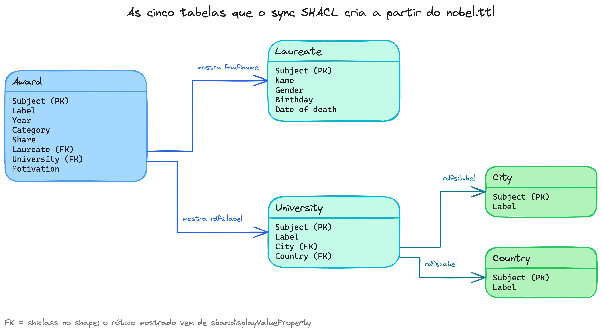

Depois do sync, as cinco tabelas aparecem em **Admin → Table Metadata**. Renomeei as tabelas e algumas colunas por ali, de `nobel__LaureateAward` para `Award`, por exemplo, só para os gráficos ficarem mais limpos. O cabeçalho de cada tabela mostra a classe RDF de origem e a estratégia que a criou.


## Consultas no query builder

Com o esquema no lugar, o query builder funciona como em qualquer banco. A consulta "universidades com mais prêmios" usa a tabela Award, com o filtro University não vazio, contagem agrupada por University, ordem decrescente e limite de 10.

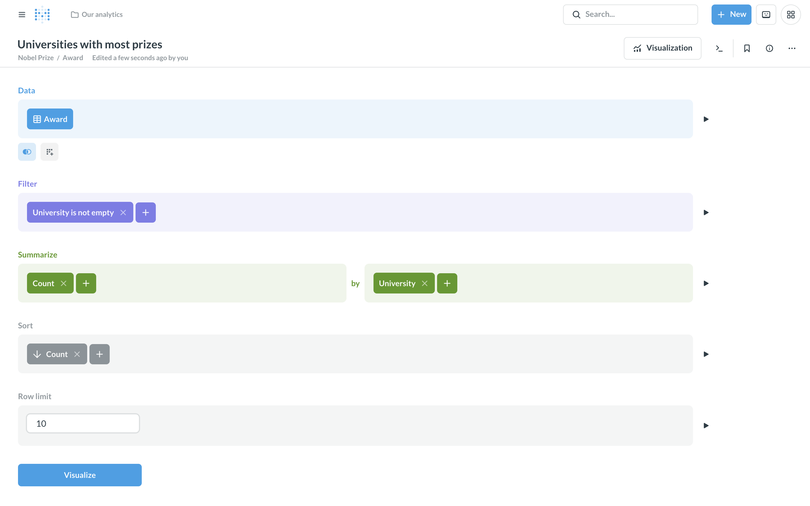

O botão "View SQL" do Metabase mostra o que o driver gerou. O rótulo diz SQL porque o Metabase não sabe que o dialeto é outro, mas o conteúdo é SPARQL:

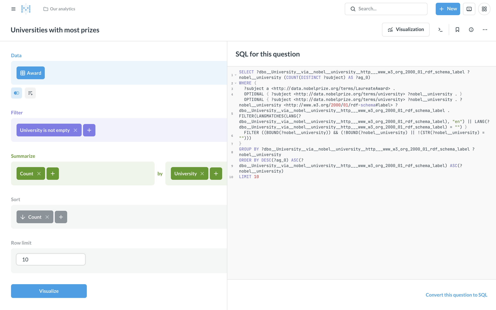

Três decisões de compilação aparecem nessa consulta:

- Cada coluna vira um `OPTIONAL`. Em RDF, uma propriedade ausente não é um `NULL`, é uma tripla que não existe. Sem `OPTIONAL`, um prêmio sem universidade sumiria da tabela inteira.
- `Count` compila para `COUNT(DISTINCT ?subject)`. Um prêmio ligado a duas universidades produz duas soluções no SPARQL, mas continua sendo um prêmio. Contar sujeitos distintos devolve o número que uma pessoa espera.
- O rótulo da universidade entra em um segundo `OPTIONAL` com `FILTER(LANGMATCHES(LANG(?label), "en") || LANG(?label) = "")`. É o Default Language da conexão em ação, aplicado só porque o SHACL declarou `rdfs:label` como `rdf:langString`.

Para o gráfico de categorias havia um problema. A categoria é uma IRI, como `http://data.nobelprize.org/resource/category/Physics`, e o endpoint não oferece rótulo para ela. Resolvi com uma coluna customizada no próprio Metabase:

```text
replace(replace([Category], "http://data.nobelprize.org/resource/category/", ""), "_", " ")
```

Chamei essa coluna de `Category name`, porque `Category` já é o nome da coluna original. O driver compila um subconjunto das expressões do Metabase (aritmética, texto, `case`, `coalesce`, casts) para `BIND`. A expressão acima, somada a uma segunda coluna `Decade`, definida como `floor([Year] / 10) * 10`, aparece assim no notebook:

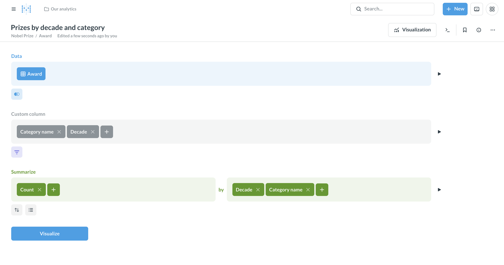

E gera este SPARQL:

```sparql
SELECT ?Decade ?Category_name (COUNT(DISTINCT ?subject) AS ?ag_0)
WHERE {
  ?subject a <http://data.nobelprize.org/terms/LaureateAward> .
  OPTIONAL { ?subject <http://data.nobelprize.org/terms/category> ?nobel__category . }
  OPTIONAL { ?subject <http://data.nobelprize.org/terms/year> ?nobel__year . }
  BIND(REPLACE(STR(REPLACE(STR(?nobel__category), "http://data\\.nobelprize\\.org/resource/category/", "")), "_", " ") AS ?Category_name)
  BIND((FLOOR(((?nobel__year + 0.0) / 10)) * 10) AS ?Decade)
}
GROUP BY ?Decade ?Category_name
ORDER BY ASC(?Decade) ASC(?Category_name)
```

Repare no `+ 0.0`. A divisão do Metabase é sempre decimal, e o driver força o operando para decimal para não depender de como cada engine SPARQL divide dois inteiros. Os pontos do namespace saem escapados como `\\.`, porque `REPLACE` em SPARQL recebe uma expressão regular. E `?Category_name` é "Category name" com o espaço trocado por `_`. Todo caractere fora de `A-Za-z0-9_` no nome de uma coluna customizada vira `_`, porque SPARQL não aceita espaços nem acentos em nomes de variáveis.

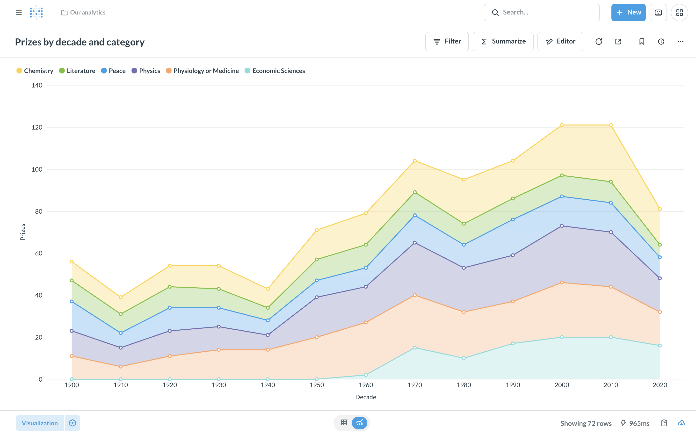

A mesma consulta das universidades, como gráfico de barras horizontais. Os nomes vêm do `rdfs:label` em inglês, via `sban:displayValueProperty`.

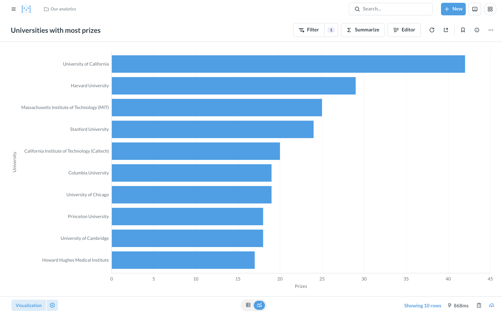

A distribuição por gênero é uma contagem na tabela Laureate. A fatia "(empty)" são os laureados sem gênero no dado, em geral organizações como o Comitê Internacional da Cruz Vermelha.

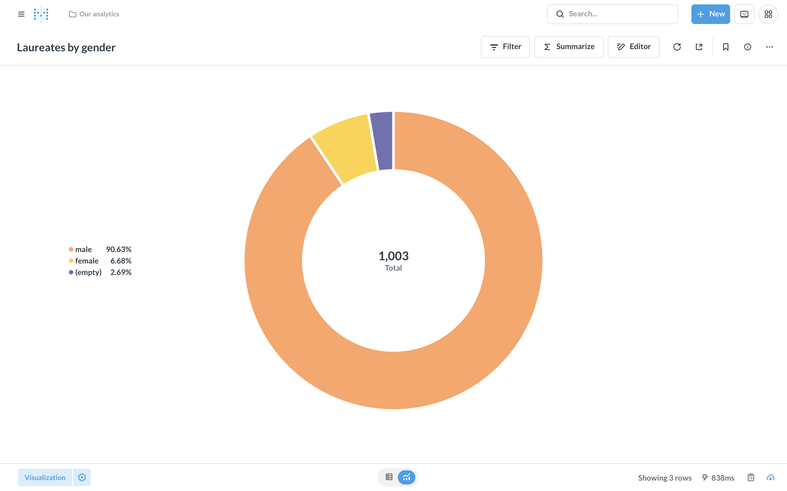

A última consulta atravessa uma chave estrangeira no filtro e traz os prêmios cujo laureado tem gênero `female`, desde 2000. O Metabase oferece as colunas de Laureate dentro do filtro de Award porque o sync declarou a chave, e o driver compila o salto como um padrão de triplas a mais no mesmo SPARQL.

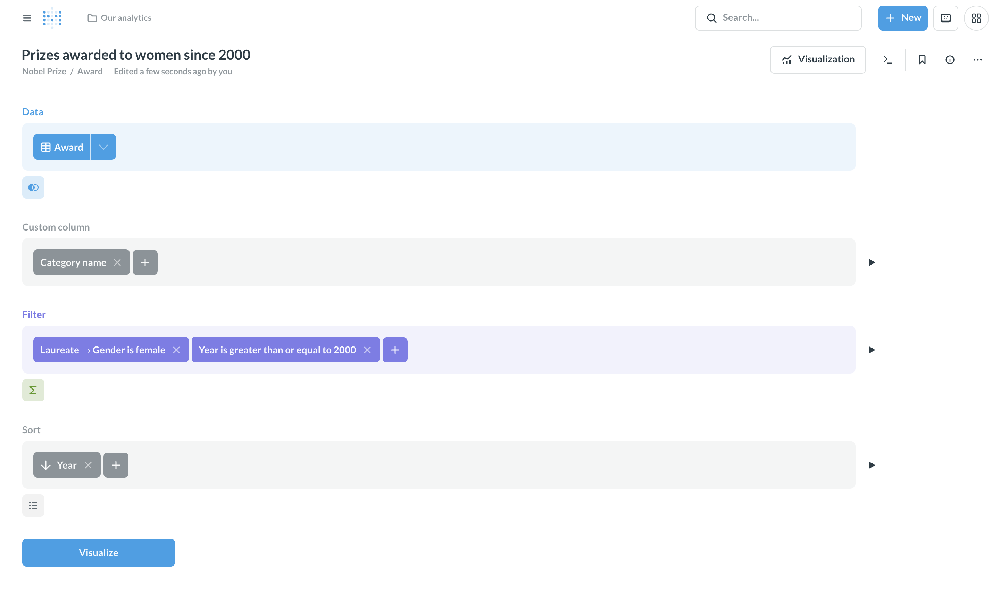

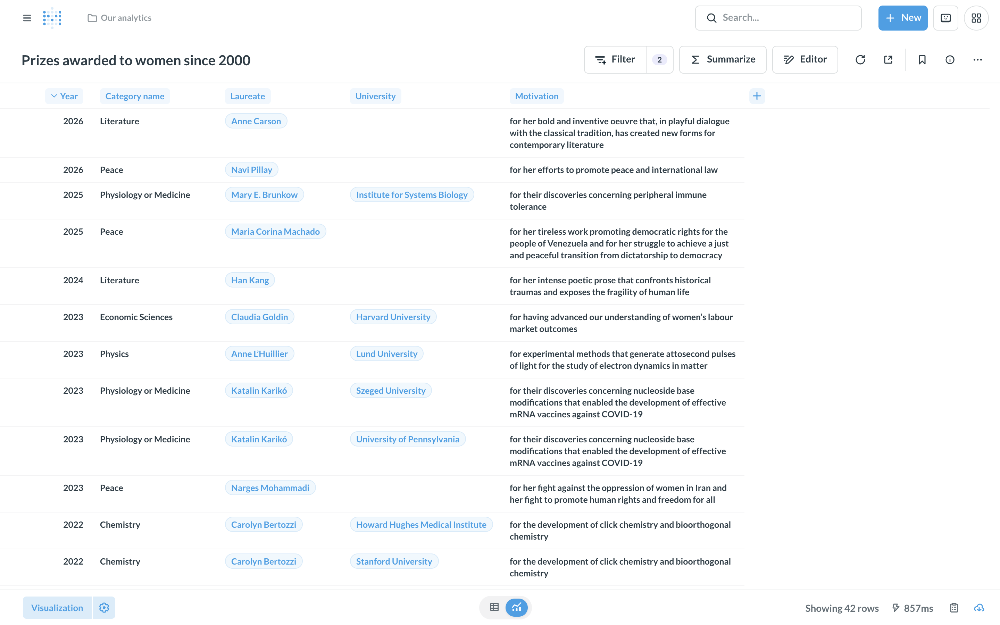

Katalin Karikó aparece em duas linhas em 2023, uma para Szeged University e outra para University of Pennsylvania. Não é um erro. No grafo, o prêmio tem duas triplas `nobel:university`, e uma tabela só consegue representar isso com duas linhas. É o tipo de diferença entre RDF e o modelo relacional que fica visível quando se olha o dado de perto. A contagem do gráfico anterior não dobra por causa do `COUNT(DISTINCT ?subject)`.

## SPARQL nativo com variáveis

Nem tudo cabe no query builder. Para contar prêmios por país preciso de dois saltos, de Award para University e de University para Country, e de um filtro de idioma no rótulo do país. Escrevi essa consulta em SPARQL direto, com uma variável de ano mínimo:

```sparql
PREFIX nobel: <http://data.nobelprize.org/terms/>
PREFIX dbo:   <http://dbpedia.org/ontology/>
PREFIX rdfs:  <http://www.w3.org/2000/01/rdf-schema#>

SELECT ?country (COUNT(DISTINCT ?award) AS ?awards)
WHERE {
  ?award a nobel:LaureateAward ;
         nobel:year ?year ;
         nobel:university ?university .
  ?university dbo:country ?c .
  ?c rdfs:label ?country .
  FILTER(LANG(?country) = "en")
  FILTER(?year >= {{min_year}})
}
GROUP BY ?country
ORDER BY DESC(?awards)
LIMIT 10
```

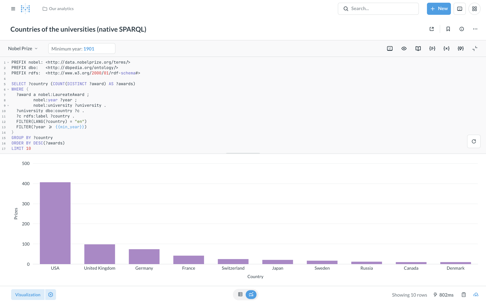

O `{{min_year}}` é uma variável do tipo número, então o driver a substitui pelo literal `1901` sem aspas. Uma variável de texto viraria `"..."` com `"` e `\` escapados, uma de data viraria `"2024-01-15"^^xsd:date`, e um valor em forma de IRI viraria `<...>`. Toda substituição passa por um único ponto de escape no driver, o mesmo usado pelos filtros do query builder, para que um valor digitado em um filtro de dashboard não consiga fechar as aspas e reescrever a consulta.

## Montando o dashboard

Com as seis consultas salvas, o dashboard é o de qualquer Metabase, com cards arrastados e um filtro "Year" do tipo intervalo numérico ligado à coluna Year dos cards feitos no query builder. A consulta nativa fica fora desse filtro porque sua variável é de valor único, mas poderia ganhar um filtro próprio.

O resultado está na captura do início do post e, completo, no fim dele. Em cada atualização do dashboard, o Metabase dispara seis consultas SPARQL ao endpoint do Nobel, que respondem em menos de um segundo cada.

Uma ressalva sobre os números é que eles retratam o grafo, não a lista oficial. Ao conferir com a API do Nobel, encontrei cerca de vinte e cinco laureados que estão na API mas não no endpoint SPARQL, entre eles Jennifer Doudna, Rita Levi-Montalcini e John Martinis. O driver mostra o que o grafo tem.

## Fechando

Fora o documento SHACL, nada neste post exigiu escrever SPARQL, e o SHACL é escrito uma vez por endpoint. Ele é o contrato que transforma um grafo em algo que o Metabase, e as pessoas que usam o Metabase, conseguem navegar como tabelas, chaves e rótulos. O mesmo documento serve de documentação do esquema e pode ser validado contra o grafo com qualquer ferramenta SHACL.

Dois pontos ficaram abertos para uma próxima versão do driver. As linhas repetidas por propriedades com vários valores, como o caso de Karikó, poderiam colapsar em uma linha por entidade na visualização de tabela. E uma quebra por uma coluna alcançada por dois saltos de chave estrangeira, como o país da universidade de um prêmio, ainda não compila com o rótulo, por isso essa consulta ficou em SPARQL nativo. Os dois estão anotados para as próximas versões.

Para terminar, o dashboard completo, com os seis cards e a tabela das laureadas desde 2000:

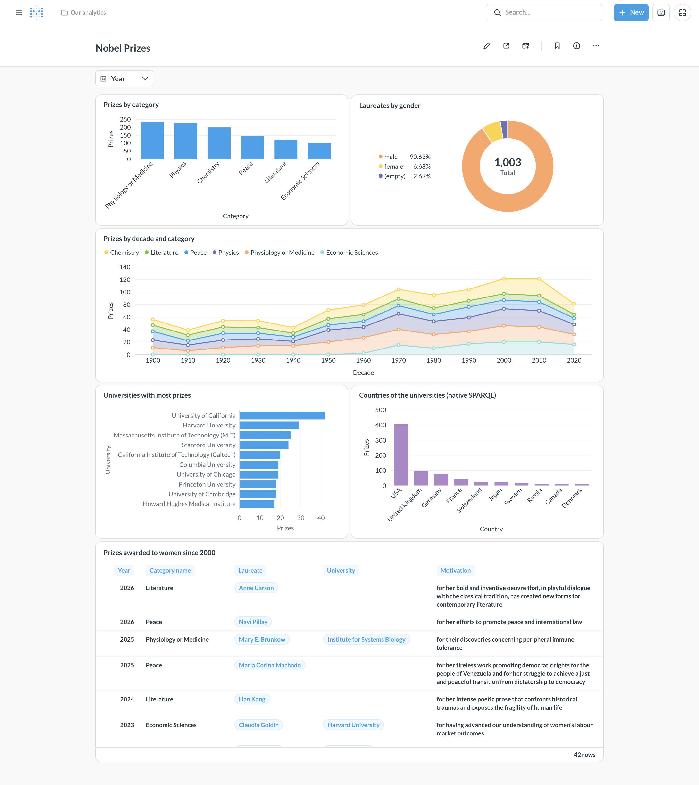
